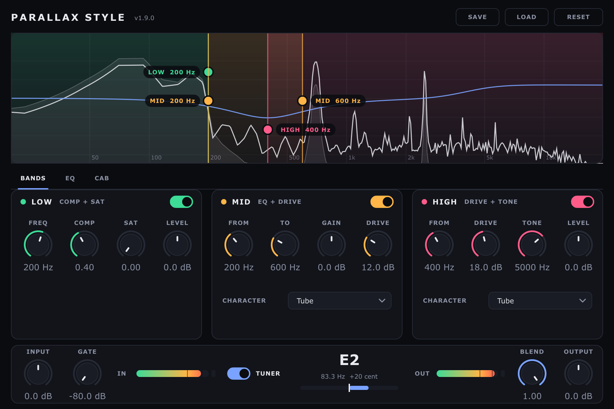

# ParallaxStyle — processore parallelo per basso

ParallaxStyle divide il segnale del basso in tre bande parallele (LOW compressa e
saturata, MID con guadagno e distorsione, HIGH distorta con cinque caratteri), le somma,
le passa per una simulazione di cassa a risposta all'impulso e per un equalizzatore a
quattro bande. Uno spettro in tempo reale mostra il segnale e le bande, che si spostano
trascinandone i bordi. È disponibile come VST3 e Standalone per Windows, macOS e Linux,
e come LV2 per il pedale Darkglass Anagram.

La guida per chi usa il plugin (installazione passo passo per ogni sistema, interfaccia,
aggiornamento, novità di ogni versione) è [`docs/ParallaxStyle.md`](docs/ParallaxStyle.md);
ogni release la contiene in PDF dentro ogni archivio.



## Struttura

| Percorso | Contenuto |
|---|---|
| `src/PluginProcessor.*` | DSP: crossover, bande, gate, IR, EQ, smoothing, tap per GUI |
| `src/PluginEditor.*`, `src/Theme.h` | interfaccia e stile |
| `src/SpectrumView.*`, `src/SpectrumAnalyzer.*`, `src/FrequencyAxis.h` | spettro live e bande trascinabili |
| `src/PitchDetector.h` | accordatore (YIN) |
| `tests/` | test GoogleTest (processor, editor, variante Anagram) e degli script di release |
| `scripts/` | versione, pacchetti, guida PDF |
| `packaging/` | script di installazione inclusi negli archivi |
| `docs/` | guida, report TDD per versione, esplorazioni |

## Build locale (Linux)

```bash
sudo apt install build-essential cmake ninja-build libasound2-dev libx11-dev libxext-dev \
    libxrandr-dev libxinerama-dev libxcursor-dev libfreetype-dev libfontconfig1-dev \
    libglu1-mesa-dev

cmake -B build -G Ninja -DCMAKE_BUILD_TYPE=Release
cmake --build build --parallel
```

Il VST3 (`ParallaxStyle-<x_y_z>.vst3`) viene copiato in `~/.vst3/`; con
`-DCOPY_PLUGIN=OFF` resta solo in `build/ParallaxStyle_artefacts/Release`. Il path del
progetto **non deve contenere spazi o parentesi** (lo script post-build VST3 di JUCE non
li gestisce).

La versione si scrive solo in `CMakeLists.txt` (`project(ParallaxStyle VERSION x.y.z)`):
la leggono i metadati del plugin, i nomi dei file, l'interfaccia, il banner di avvio e la
CI. Nei nomi dei plugin compare con i trattini bassi (`1_9_0`) perché il loader del VST3
SDK su Linux tratta come estensione il testo dopo l'ultimo punto.

## Test

```bash
sudo apt install xvfb gcovr pandoc   # anche Google Chrome per la guida PDF
cmake -B build-tests -G Ninja -DCMAKE_BUILD_TYPE=Debug -DCOPY_PLUGIN=OFF \
    -DPARALLAXSTYLE_TESTS=ON -DPARALLAXSTYLE_SANITIZERS=ON -DPARALLAXSTYLE_COVERAGE=ON
cmake --build build-tests --parallel
xvfb-run -a ctest --test-dir build-tests --output-on-failure
gcovr --root . --filter src/ --object-directory build-tests --print-summary
```

- `ParallaxStyleTests`: DSP, stato, preset, IR, smoothing (nessun click girando le
  manopole), blocchi oltre la dimensione annunciata, nessuna allocazione nel thread
  audio, editor (versione visibile, controlli dentro la finestra e senza sovrapposizioni,
  ogni parametro collegato a un controllo), spettro, accordatore.
- `ParallaxStyleAnagramTests`: la variante Anagram del processor compilata in nativo
  (bypass, reset, abbreviazione, registri della CPU).
- `ReleaseScripts`: controllo versione/tag, pacchetti, script di installazione, guida PDF.

Ogni `jassert` di JUCE fa fallire il test in corso. Per guardare l'interfaccia:

```bash
SNAP_DIR=/tmp xvfb-run -a build-tests/tests/ParallaxStyleTests_artefacts/Debug/ParallaxStyleTests \
    --gtest_filter='EditorSnapshot.*'     # scrive /tmp/editor-0.png, -1, -2
```

## CI e release

- `.github/workflows/build.yml` gira su ogni pull request e su ogni tag `v*`: test con
  AddressSanitizer e UBSan e copertura di `src/` (almeno 80% delle righe), poi build su
  Linux, Windows e macOS (universal), [pluginval](https://github.com/Tracktion/pluginval)
  a strictness 10, avvio dello Standalone, guida PDF, archivi e controlli dell'azione
  condivisa `Darkglassd3v/.github/actions/release`. Sui tag pubblica la release, con le
  note brevi prese dalla sezione "Novità della versione" della guida. Nessun artifact
  delle Actions: gli archivi vanno solo nella release.
- `.github/workflows/pulizia-branch.yml` (manuale, come in dierre) chiude i branch
  elencati solo se sono già contenuti in `main` o in un tag; con `dry_run` dice soltanto
  cosa farebbe.
- `.github/workflows/build-anagram.yml` cross-compila l'LV2 per Anagram (circa 1 ora) sui
  tag, a mano e sulle pull request che lo modificano, e aggiunge il suo archivio alla release.

Ogni versione si sviluppa sul branch `release/v<versione>` creato da `main`, con una pull
request verso `main`; si unisce con un merge commit quando la CI è verde, poi il tag
`v<versione>` su `main` avvia la release. Prima del tag: versione in `CMakeLists.txt` e
sezione `## Novità della versione <versione>` in `docs/ParallaxStyle.md`.

## Build per Darkglass Anagram (LV2)

Il pedale [Darkglass Anagram](https://www.darkglass.com/products/anagram/) gira
un Linux ARM64 custom senza display server: i plugin di terze parti vanno
formato **LV2** (Control Ports, non Patch Parameters) seguendo le regole di
[Plugin-Dev-Setup](https://github.com/Darkglass-Electronics/Plugin-Dev-Setup)
e usando il wrapper
[juce-anagram-lv2](https://github.com/Darkglass-Electronics/juce-anagram-lv2).

Il flag CMake `TARGET_ANAGRAM` abilita questa build al posto di quella
desktop, usando lo stesso codice DSP condiviso con alcune differenze:

- **Nessuna GUI**: Anagram non ha display server (niente X11/OpenGL), quindi
  per questo target `createEditor()` ritorna `nullptr` e il file
  `PluginEditor.cpp` non viene nemmeno compilato.
- **Niente Cab IR**: il caricamento di IR custom via file chooser non è
  supportato lato hardware (l'unico caso supportato è `Atom:Path` usato dai
  blocchi ufficiali tipo Cabinet Loader). Lo stadio di convoluzione, i
  parametri "Cab IR"/"IR Level" e il loro salvataggio in stato/preset sono
  quindi esclusi da questa build: la simulazione cassa va aggiunta in
  cascata come blocco Anagram separato.
- **Niente accordatore**: non essendoci un display, il parametro "Tuner" e
  tutta la pipeline FIFO/YIN correlata sono esclusi da questa build.
- **Bypass**: Anagram richiede una `lv2:enabled` Control Port dedicata, qui
  esposta come parametro `bypass` (assente invece dalla build desktop, per
  non spostare gli indici dei parametri già usati in automazioni/preset
  esistenti). Il plugin la gestisce da sé con una dissolvenza di 50 ms.
- **Requisiti Darkglass**: abbreviazione `PLX` (`getAlternateDisplayNames`),
  `reset()` che azzera tutto lo stato (porta `kx:Reset`, due istanze mono
  restano allineate), nessuna modifica ai registri flush-to-zero della CPU,
  smoothing su tutti i parametri continui.

Tutto questo è pilotato dalla macro `PARALLAXSTYLE_ANAGRAM_BUILD` (0/1),
impostata in `CMakeLists.txt` in base a `TARGET_ANAGRAM`.

### Prerequisiti

Il pedale usa un toolchain di cross-compilazione dedicato (crosstool-ng via
[mod-plugin-builder](https://github.com/mod-audio/mod-plugin-builder/)), da
buildare **una volta sola** seguendo
[BUILDING-LINUX.md](https://github.com/Darkglass-Electronics/Plugin-Dev-Setup/blob/main/BUILDING-LINUX.md)
(nativo su Linux) o
[BUILDING-DOCKER.md](https://github.com/Darkglass-Electronics/Plugin-Dev-Setup/blob/main/BUILDING-DOCKER.md)
(macOS/Windows, via Docker). Non è incluso nella CI di questo repo: è un
processo pesante (~1 ora, ~15 GB): in questo repository lo esegue il workflow
`build-anagram.yml` sui tag di release, a mano e sulle pull request che lo modificano.

### Build (via Docker, riassunto)

```bash
# 1) build one-off del toolchain (vedi BUILDING-DOCKER.md per i dettagli)
docker buildx build --build-arg target=full --tag darkglass-anagram \
    /path/to/Plugin-Dev-Setup/docker

# 2) container con il progetto montato
docker run --name anagram-build -ti \
    -v /path/to/ParallaxStyle:/root/source \
    darkglass-anagram:latest

# 3) dentro il container: build directory SEPARATA da quella desktop
#    (il fetch di JUCE è patchato per la cross-compilazione, non va
#    mescolato con una build directory desktop già configurata)
cmake -S /root/source -B /root/source/build-anagram -DTARGET_ANAGRAM=ON -DCMAKE_BUILD_TYPE=Release
$(which cmake) --build /root/source/build-anagram
```

L'LV2 bundle finito si trova in
`build-anagram/ParallaxStyle_artefacts/Release/LV2/ParallaxStyle-<x_y_z>.lv2/`.

### Deploy su un'unità in Developer Mode

```bash
ssh root@192.168.51.1 "rm -rf /root/.lv2/ParallaxStyle*.lv2"
scp -O -r ParallaxStyle-1_9_0.lv2 root@192.168.51.1:/root/.lv2/
ssh root@192.168.51.1 "systemctl restart jack2 lvgl-app"
```

### Note

- `assets/anagram/block-on.png` e `block-off.png` (200×200) riprendono lo stile
  dell'interfaccia: tre barre parallele nei colori delle bande. Si rigenerano con
  `python3 scripts/make-anagram-blocks.py` (serve Pillow).
- La categoria LV2 (`lv2:DistortionPlugin`, vedi
  [CATEGORIES.md](https://github.com/Darkglass-Electronics/Plugin-Dev-Setup/blob/main/CATEGORIES.md))
  e gli altri metadati Anagram vanno verificati al primo test sull'hardware reale:
  i test del repository coprono la variante Anagram compilata in nativo e la
  cross-compilazione in CI, non il pedale.
