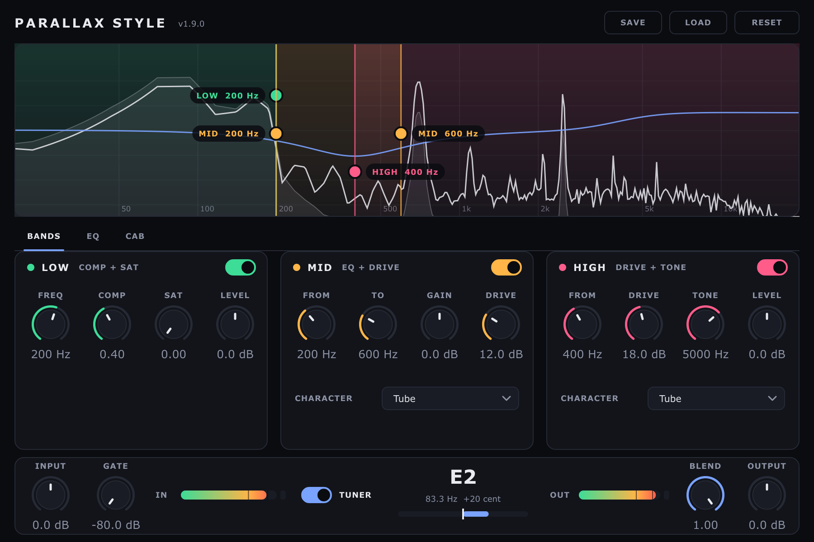

## Che cos'è

ParallaxStyle è un processore parallelo per basso elettrico, disponibile come plugin
VST3 e come applicazione Standalone per Windows, macOS e Linux, e come plugin LV2 per
il pedale Darkglass Anagram. Il segnale si divide in tre bande che lavorano in parallelo:

- **LOW**: le basse frequenze, compresse e saturate per un fondamentale pieno e stabile;
- **MID**: una banda medio-bassa regolabile, con guadagno e distorsione propria;
- **HIGH**: le frequenze alte, distorte con uno dei cinque caratteri disponibili.

Le tre bande si sommano, passano per la simulazione di cassa (IR) e per un equalizzatore
a quattro bande, e arrivano all'uscita con un controllo di miscela tra suono pulito ed
elaborato. In alto, uno spettro in tempo reale mostra il segnale e le bande, che si
spostano trascinandone i bordi.



## Il percorso del segnale

```
ingresso ─► Input ─► Gate ─┬─► LOW:  passa-basso ─► Comp ─► Sat ─► Level ───────┐
                           ├─► MID:  passa-banda ─► Drive ─► Gain ──────────────┤
                           └─► HIGH: passa-alto ─► Drive ─► Tone ─► [IR] ─► Level ┤
                                                                                  ▼
       uscita ◄─ Blend ◄─ Output ◄─ EQ ◄─ [IR] ◄─────────────────────────────── Σ
```
Il crossover usa filtri Linkwitz-Riley del quarto ordine. Le tre bande sono indipendenti:
LOW e MID possono sovrapporsi, e ognuna si spegne con il suo interruttore.

## Scaricare

Ogni versione si trova nella pagina delle release del progetto:

<https://github.com/Darkglassd3v/ParallaxStyle/releases>

Per ogni sistema ci sono due archivi, e ognuno contiene anche questa guida. Nel nome dei
plugin la versione ha i trattini bassi (`ParallaxStyle-1_9_0.vst3`), perché alcune DAW
leggono il testo dopo l'ultimo punto come estensione del file.

| Archivio | Contenuto |
|---|---|
| `ParallaxStyle-<versione>-windows-vst3.zip` | plugin VST3 e `install.bat` |
| `ParallaxStyle-<versione>-windows-standalone.zip` | `ParallaxStyle-<versione>.exe` |
| `ParallaxStyle-<versione>-macos-vst3.zip` | plugin VST3 (Apple Silicon e Intel) e `install.sh` |
| `ParallaxStyle-<versione>-macos-standalone.zip` | `ParallaxStyle-<versione>.app` |
| `ParallaxStyle-<versione>-linux-vst3.zip` | plugin VST3 e `install.sh` |
| `ParallaxStyle-<versione>-linux-standalone.zip` | programma `ParallaxStyle-<versione>` |
| `ParallaxStyle-<versione>-anagram-lv2.zip` | plugin LV2 per Darkglass Anagram |

Dal terminale, con la GitHub CLI installata, si scarica una versione così (esempio per Linux):

```bash
gh release download v1.9.0 --repo Darkglassd3v/ParallaxStyle --pattern 'ParallaxStyle-1.9.0-linux-*.zip'
```

## Installare

Lo script di installazione rimuove ogni versione precedente di ParallaxStyle prima di
copiare quella nuova, così la DAW ne vede una sola.

### Windows

1. Scarica `ParallaxStyle-1.9.0-windows-vst3.zip`.
2. Tasto destro sull'archivio, **Estrai tutto**.
3. Nella cartella estratta, tasto destro su `install.bat`, **Esegui come amministratore**.
   Il plugin va in `C:\Program Files\Common Files\VST3\ParallaxStyle-1_9_0.vst3`.
4. Riavvia la DAW e fai una nuova scansione dei plugin.

Per l'applicazione Standalone estrai `ParallaxStyle-1.9.0-windows-standalone.zip` e apri
`ParallaxStyle-1.9.0.exe`. Il programma non è firmato: se Windows SmartScreen lo blocca,
scegli **Ulteriori informazioni**, poi **Esegui comunque**.

### macOS

1. Scarica `ParallaxStyle-1.9.0-macos-vst3.zip` e fai doppio clic per estrarlo.
2. Apri il Terminale ed esegui lo script di installazione:

   ```bash
   cd ~/Downloads/ParallaxStyle-1.9.0-macos-vst3
   bash install.sh
   ```

   Il plugin va in `~/Library/Audio/Plug-Ins/VST3`, senza l'attributo di quarantena dei
   file scaricati.
3. Riavvia la DAW e fai una nuova scansione dei plugin.

Per l'applicazione Standalone estrai `ParallaxStyle-1.9.0-macos-standalone.zip`, sposta
`ParallaxStyle-1.9.0.app` in **Applicazioni** e, la prima volta, aprila con tasto destro,
**Apri**. Se macOS dice che l'app è danneggiata, togli la quarantena:

```bash
xattr -cr /Applications/ParallaxStyle-1.9.0.app
```

### Linux

```bash
cd ~/Downloads
unzip ParallaxStyle-1.9.0-linux-vst3.zip -d ParallaxStyle-1.9.0-linux-vst3
bash ParallaxStyle-1.9.0-linux-vst3/install.sh
```

Il plugin va in `~/.vst3`. Per l'applicazione Standalone:

```bash
unzip ParallaxStyle-1.9.0-linux-standalone.zip -d ParallaxStyle-1.9.0-linux-standalone
./ParallaxStyle-1.9.0-linux-standalone/ParallaxStyle-1.9.0
```

### Darkglass Anagram

Il pedale deve essere in Developer Mode e collegato via USB (indirizzo `192.168.51.1`).

```bash
unzip ParallaxStyle-1.9.0-anagram-lv2.zip -d ParallaxStyle-1.9.0-anagram
ssh root@192.168.51.1 "rm -rf /root/.lv2/ParallaxStyle*.lv2"
scp -O -r ParallaxStyle-1.9.0-anagram/ParallaxStyle-1_9_0.lv2 root@192.168.51.1:/root/.lv2/
ssh root@192.168.51.1 "systemctl restart jack2 lvgl-app"
```

Sul pedale il blocco si chiama ParallaxStyle (abbreviazione **PLX**). Non ha la
simulazione di cassa né l'accordatore, che su Anagram sono blocchi a parte; l'interruttore
del blocco lo esclude con una dissolvenza di 50 ms.

## Avviare

All'avvio la versione è scritta accanto al titolo, in alto a sinistra (`v1.9.0`).
L'applicazione Standalone la scrive anche nella console (`ParallaxStyle 1.9.0`).

Nell'applicazione Standalone scegli l'ingresso e l'uscita audio dal pulsante
**Options**, **Audio/MIDI Settings**. Nella DAW inserisci ParallaxStyle su una traccia di
basso come effetto in insert.

## L'interfaccia

### Lo spettro e le bande

La parte alta mostra lo spettro dell'ingresso (area grigia) e dell'uscita (linea bianca),
da 20 Hz a 20 kHz. Sopra lo spettro ci sono le tre bande colorate: LOW in verde, MID in
ambra, HIGH in rosa. Trascinando i pallini sui bordi si spostano le frequenze di taglio;
un doppio clic riporta il bordo al valore predefinito. Quando l'equalizzatore post è in
uso compare anche la sua curva, in blu.

### BANDS

Una scheda per banda, ciascuna con il suo interruttore. Una banda spenta si oscura e non
consuma calcolo.

| Banda | Controlli |
|---|---|
| LOW | FREQ (taglio, 60-500 Hz), COMP (0-1), SAT (0-1), LEVEL (-24/+24 dB) |
| MID | FROM e TO (estremi della banda), GAIN (-24/+24 dB), DRIVE (0-40 dB), CHARACTER |
| HIGH | FROM (taglio, 100-2000 Hz), DRIVE (0-40 dB), TONE (1-12 kHz), LEVEL (-24/+24 dB), CHARACTER |

I caratteri di distorsione sono **Tube** (saturazione morbida), **Rodent** (clipping
stretto), **Fuzz** (asimmetrico), **Doom** (quasi un'onda quadra) e **X** (due stadi CMOS).
COMP abbassa la soglia fino a -50 dB e alza il rapporto fino a 12:1, con guadagno di
compensazione automatico.

### EQ

Equalizzatore a quattro bande sul mix: shelving basso (40-250 Hz), due bande a campana
(100-2000 Hz e 500-8000 Hz) e shelving alto (1-12 kHz), ciascuna ±15 dB.

### CAB

**POSITION** decide dove agisce la risposta all'impulso (IR) della cassa: **Off**, solo
sulla banda **High Band**, oppure sul **Full Mix**. **LOAD IR** carica un file WAV, AIFF o
FLAC; il nome compare sotto. **IR LEVEL** regola il volume dopo la cassa. Il percorso
dell'IR si salva nella sessione e nei preset.

### La barra inferiore

**INPUT** e **GATE** (soglia del noise gate, -80 dB vuol dire aperto), i misuratori **IN**
e **OUT** con il LED di clip, l'accordatore (**TUNER**), **BLEND** (0 pulito, 1 elaborato)
e **OUTPUT**.

L'accordatore mostra la nota, la frequenza e lo scostamento in cent; la nota diventa
verde entro ±5 cent. Funziona dal Si basso (31 Hz) in su.

### Preset

**SAVE** salva tutti i controlli e l'IR in un file `.pllx` (di solito in
`Documenti/ParallaxStyle`), **LOAD** lo ricarica, **RESET** riporta tutto ai valori
predefiniti.

## Aggiornare

1. Scarica gli archivi della nuova versione.
2. Esegui di nuovo lo script di installazione (`install.bat`, `install.sh`, o i comandi per
   Anagram): toglie la versione precedente e installa quella nuova.
3. Riavvia la DAW e fai una nuova scansione dei plugin.

Le sessioni e i preset restano validi: la DAW riconosce ParallaxStyle come lo stesso
plugin anche se il nome del file cambia con la versione.

## Se qualcosa non va

| Problema | Cosa fare |
|---|---|
| La DAW non vede il plugin | Controlla che la cartella del plugin sia tra quelle analizzate dalla DAW e fai una nuova scansione. |
| Compaiono due ParallaxStyle | Una versione è stata copiata a mano: esegui di nuovo lo script di installazione, che le toglie tutte prima di copiare. |
| macOS dice che il file è danneggiato | `xattr -cr` sul plugin o sull'app (vedi Installare, macOS). |
| Windows blocca l'applicazione | SmartScreen: **Ulteriori informazioni**, **Esegui comunque**. |
| Lo Standalone non suona | **Options**, **Audio/MIDI Settings**: scegli ingresso e uscita. |
| L'accordatore mostra solo un trattino | Il segnale è troppo basso, oppure l'accordatore è spento (TUNER). |
| Dopo aver spostato i file l'IR non suona | Ricarica l'IR con **LOAD IR**: il percorso salvato non esiste più. |

## Novità della versione 1.9.0

### Novità

- **Interfaccia nuova**: scura e minimale, un colore per banda, pagine BANDS, EQ e CAB, barra inferiore con ingresso, misuratori, accordatore e uscita.
- **Spettro in tempo reale**: mostra ingresso e uscita con le tre bande sopra; i bordi delle bande si trascinano per spostarle e il doppio clic li riporta al valore predefinito.
- **Curva dell'equalizzatore** disegnata sullo spettro quando l'EQ è in uso.
- **Versione sempre visibile**: accanto al titolo, nella console dello Standalone e nei nomi dei file (`ParallaxStyle-1.9.0.exe`, `ParallaxStyle-1.9.0.app`, `ParallaxStyle-1_9_0.vst3`).
- **Release complete**: ogni archivio contiene la guida in PDF; gli script di installazione tolgono le versioni precedenti; il plugin per Anagram è pubblicato insieme agli altri.

### Correzioni

- **Niente più click** quando si girano COMP, SAT, DRIVE dei medi, i crossover, il TONE o i guadagni dell'EQ, o quando si accende e spegne una banda: ora ogni cambio scorre in 50 ms.
- **Niente più rischio di crash** se la DAW manda blocchi audio più grandi di quelli annunciati.
- **L'EQ non alloca più memoria** nel thread audio mentre si muovono le sue manopole.
- **Il LED di clip** si spegne un secondo dopo l'ultimo clip invece di restare acceso.
- **L'accordatore** mostra i cent arrotondati (prima, per esempio, "+19.8639 cent").
- **Darkglass Anagram**: l'interruttore del blocco ora esclude davvero l'effetto, con una dissolvenza; due istanze mono si risincronizzano al reset; il plugin non cambia più le impostazioni della CPU e ha l'abbreviazione PLX.
- **Build per Anagram**: la pubblicazione non si interrompe più a fine compilazione (cercava il plugin nella cartella sbagliata).

## Novità della versione 1.8.0

- **Darkglass Anagram**: prima build LV2 per il pedale, senza interfaccia, simulazione di cassa e accordatore, con un parametro di bypass.

## Novità della versione 1.7.1

- Titoli delle bande più leggibili; le colonne si oscurano quando una banda o l'IR sono spenti.

## Novità della versione 1.7.0

- Compressione della banda bassa udibile, con guadagno di compensazione; distorsione sui medi; livelli fino a +24 dB; pulsante RESET.

## Novità della versione 1.6.0

- Tre bande che si spengono singolarmente, caratteri X (CMOS) e Doom, noise gate deciso, EQ post a quattro bande, livello dell'IR, salvataggio e caricamento dei preset, script di installazione negli archivi.
